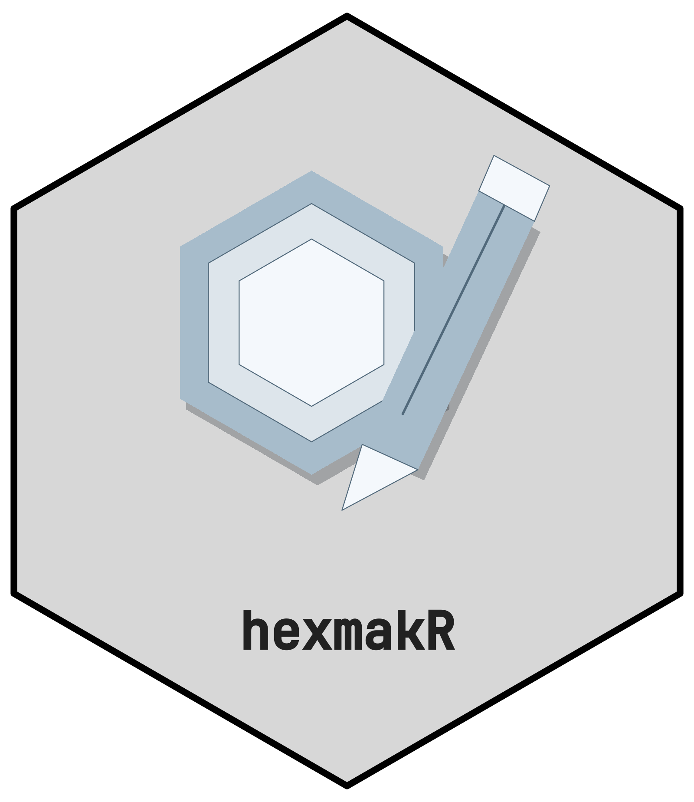

<picture class="cttir-readme-logo"><source class="cttir-logo-dark-source" media="(prefers-color-scheme: dark)" srcset="man/figures/logo-with-name-dark.png" /></picture>

# hexmakR

[](https://doi.org/10.5281/zenodo.21889938)

<!-- badges: start -->
[](https://github.com/CTTIR/hexmakR/actions/workflows/R-CMD-check.yaml)
[](https://cttir.github.io/hexmakR/)
[](https://CRAN.R-project.org/package=hexmakR)
[](https://app.codecov.io/gh/CTTIR/hexmakR?branch=main)
[](https://cran.r-project.org/package=hexmakR)
[](https://cran.r-project.org/package=hexmakR)
[](https://opensource.org/licenses/MIT)
[](https://lifecycle.r-lib.org/articles/stages.html#experimental)
<!-- badges: end -->

## Overview

hexmakR creates editable logos for R packages and projects. The default
Designer starts a **new logo with your name and a blank frame**. Choose a
hexagon, pentagon or square, then add shapes, uploaded artwork or a generic icon and edit each
part. Names stay **inside the frame** and the exterior is transparent.

The secondary **CTTIR Gallery** contains 45 identities and 1,035 original
SVG/PNG/PDF assets. Browse for inspiration, import one selected part or an
entire motif into your current logo, or explicitly start from a whole archived
design. Browsing the archive does not replace your work.

Click a visible part to select it, then drag it to a new position. Short item
names and Frame/Icon/Name groups help organise the composition; custom groups
can be renamed, regrouped and moved together. The editor supports individual
fills, outlines, positions, sizes, rotation, opacity, visibility and point
coordinates, plus duplicate/remove, undo/reset, JSON
projects and PNG/SVG/PDF export. All 46 generic icons are available. The
classic designer retains its 19 themes, custom image uploads and font controls.

```r
library(hexmakR)
hexmakr_app()                          # fresh logo; optional CTTIR Gallery tab
hexmakr_app(package = "phenoscapR")     # preselect archive, keep fresh logo
hexmakr_app(workspace = "classic")      # original generic sticker designer

project <- logo_design("My project", shape = "pentagon")
project <- hex_add_part(project, "circle", x = .5, y = .6, r = .15)
project <- hex_edit_layer(project, "part_0001", fill = "#45B59A")
hex_export(project, "project.png")

# Reuse archive artwork while keeping the new name, frame and existing parts.
project <- hex_reuse_part(project, "phenoscapR")
hex_save_design(project, "project.json")
hex_export(project, "project.svg")

# An explicit identity still opens that complete editable archive design.
hex_export(hex_design("phenoscapR"), "phenoscapR.svg")
```

See the [detailed update plan](plans/2026-10-27-v5-update.md) and
[v5 library guide](https://cttir.github.io/hexmakR/articles/cttir-library.html).

## Standing on the shoulders of `hexSticker`

The excellent [`hexSticker`](https://github.com/GuangchuangYu/hexSticker)
package by [Guangchuang Yu](https://yulab-smu.top) is the original and
most widely used hex sticker generator in the R ecosystem. Available on
[CRAN](https://cran.r-project.org/package=hexSticker), it provides a
powerful programmatic API built on ggplot2 that lets you embed any R plot,
lattice graphic, ggplot, or image file into a hex sticker — and hundreds
of R package stickers have been created with it.

**`hexmakR` is not a replacement for `hexSticker` — it is a complement.**
If you want to embed an actual R plot (base, lattice, or ggplot2) into your
sticker, `hexSticker` is the right tool. It excels at code-first,
reproducible sticker generation with full control over subplot positioning.

`hexmakR` fills a different niche. It focuses on:

- **Interactive visual design** — a Shiny app where you see changes live
  and export when you're happy, no code required
- **A curated theme library** — 19 domain-specific color palettes
  (Statistics, Bioinformatics, Genomics, Pharma, CRAN, Bioconductor,
  Tidyverse, and more) with one-click dark/light switching
- **A built-in icon library** — 46 hand-drawn scientific and technical
  icons across 7 categories, so you don't need external image files
- **Font selection** — choose from 13 fonts with bold/italic toggles
  directly in the UI
- **Zero-to-sticker speed** — designed for the case where you want a
  good-looking hex sticker in under a minute without writing any code

We recommend trying both and using whichever fits your workflow. For many
users, the best approach is to prototype in `hexmakR`'s Shiny app and
then fine-tune programmatically — with either package.

## Installation

```r
# Development version
# install.packages("pak")
pak::pak("cttir/hexmakR")
```

## Quick Start

```r
library(hexmakR)

logo <- logo_design("My package")
logo <- hex_add_part(logo, "polygon",
                     x = c(.35, .65, .5), y = c(.45, .45, .75))
hex_layers(logo)
hex_export(logo, "my-package.svg")
```

`logo_design()` starts with a frame and name, with no archived motif.
Pass `motif = "phenoscapR"` or another identity only when that artwork is
wanted. Use `shape = "pentagon"` or `shape = "square"` for project logos.

## Shiny App

```r
hexmakr_app()
```

Enter your name and choose a frame, then select **Apply logo settings**.
**Add part** creates a circle, rectangle, line or triangle. Select a part,
change its properties or points, and choose **Apply part edit**. **Duplicate
part** and **Remove part** act on the selection. The CTTIR Gallery tab offers
**Add selected part to my logo**, **Add artwork to my logo**, and the separate
**Start from whole design** action.

**Undo** restores the previous edit. **Reset to starting design** restores the
current session baseline: the new logo, the explicitly loaded archive design,
or the opened JSON project. **New logo** starts fresh and can also be undone.
Downloads use the applied design; pending form changes must be applied first.
**Save project** preserves editable parts and **R recipe** reproduces them.

Use **Add an image or vector drawing** for PNG/JPEG figures or SVG artwork.
PNG/JPEG remains one movable, scalable and rotatable image with editable
opacity. Supported SVG shapes become individual vector parts. Both are
embedded in the project, so reopening needs no original upload file.

```r
project <- hex_import_art(logo_design("My project"), "figure.svg")
project <- hex_label_layer(project, "part_0001", "Central cell")
project <- hex_edit_layer(project, "part_0001", angle = 25, alpha = .8)
hex_groups(project)
```

Uploads are limited to 10 MiB; projects to 20 MiB. SVG supports solid-colour
paths/shapes, transforms and local references. Curves become bounded vector
polylines, and SVG/PDF exports keep that vector geometry. Outline text and
flatten gradients, masks, filters or intersecting clips before uploading;
unsupported features produce an explanatory error. Raster content stays raster
inside SVG/PDF exports. The application title is the text **hexmakR**.

## Classic designer comparison

| Feature | hexSticker | hexmakR |
|---------|-----------|---------|
| Embed R plots (base/lattice/ggplot2) | ✅ | — |
| Interactive Shiny designer | — | ✅ |
| Built-in icon library (46 icons) | — | ✅ |
| Curated theme presets (19 themes) | — | ✅ |
| Dark/light mode toggle | — | ✅ |
| Custom image upload | ✅ | ✅ |
| Font selection UI | — | ✅ |
| Google Fonts support | ✅ | — |
| Programmatic API | ✅ | ✅ |
| Returns ggplot object | ✅ | ✅ |
| Installation | CRAN | GitHub development version |

## Available Themes

| Key | Label |
|-----|-------|
| `stats` | Statistics |
| `viz` | Data Visualization |
| `bio` | Biology |
| `medical` | Medical |
| `tech` | Technology |
| `earth` | Earth Sciences |
| `cran` | CRAN |
| `bioc` | Bioconductor |
| `tidy` | Tidyverse |
| `genomics` | Genomics |
| `proteo` | Proteomics |
| `pharma` | Pharma |
| `ocean` | Ocean |
| `midnight` | Midnight |
| `cyber` | Cyberpunk |
| `neon` | Neon |
| `sunset` | Sunset |
| `viridis` | Viridis |
| `plasma` | Plasma |

Each classic theme has both `dark` and `light` variants.

## Available Icons

| Category | Count | Icons |
|----------|-------|-------|
| `science` | 5 | atom, flask, microscope, molecule, magnet |
| `biology` | 6 | dna, cell, brain, leaf, bacteria, tree |
| `stats` | 8 | bar_chart, scatter, line_chart, bell_curve, pie, sigma, boxplot, network |
| `medical` | 6 | stethoscope, heart, pulse, pill, cross, syringe |
| `tech` | 6 | terminal, brackets, gear, database, hash, rlogo |
| `shapes` | 7 | star, shield, diamond, hexagon, infinity, arrow_up, circle |
| `fun` | 8 | rocket, lightning, fire, sparkle, crown, coffee, music, gamepad |

## Vignettes

- [Creating and reusing parts](https://cttir.github.io/hexmakR/articles/cttir-library.html)
- [Getting Started](https://cttir.github.io/hexmakR/articles/getting-started.html)
- [Programmatic Usage](https://cttir.github.io/hexmakR/articles/programmatic-usage.html)
- [Shiny App](https://cttir.github.io/hexmakR/articles/shiny-app.html)

## Contributing

Contributions are welcome! Please open an issue first to discuss major
changes at [github.com/cttir/hexmakR/issues](https://github.com/cttir/hexmakR/issues).

## Code of Conduct

Please note that the hexmakR project is released with a
[Contributor Code of Conduct](https://contributor-covenant.org/version/2/1/code_of_conduct.html).
By contributing to this project, you agree to abide by its terms.

## Acknowledgements

hexmakR was inspired by the pioneering work of the
[`hexSticker`](https://github.com/GuangchuangYu/hexSticker) package. We are
grateful to Guangchuang Yu and all contributors for establishing hex stickers
as a staple of R package identity.

## Citation

If you use this software, please cite it as:

> Heller, R. (2026). *hexmakR: Interactive hex sticker generator for R packages* (Version 0.1.0) [Computer software]. Zenodo. https://doi.org/10.5281/zenodo.21889938

DOI: [10.5281/zenodo.21889938](https://doi.org/10.5281/zenodo.21889938)

## Use of LLM tools

Where applicable, LLM tools were used for narrowly defined, non-authorial tasks:
copyediting, prose refinement, Markdown/LaTeX formatting, boilerplate scaffolding
(such as CI configurations and build scripts), and code refactoring. Tools included
[Chat AI](https://kisski.gwdg.de/leistungen/2-02-llm-service/), the KISSKI
(GWDG) service, and self-hosted **Mistral Small (24B, Apache-2.0)** served through
a local **vLLM architecture** on an Ubuntu Linux workstation with Intel
processors and NVIDIA GPUs. The self-hosted model ran locally, with no data sent
to third parties.

All scientific claims, methodological choices, analyses, interpretations and
conclusions remain the authors' own. Where applicable, LLM-generated material
must be reviewed and revised before inclusion, and references must be verified
against their DOI, arXiv ID or ISBN.

Local software setup: vLLM with Python/PyTorch, plus R and RStudio.

## Package branding

The package uses the CTTIR Coder Edition v5 v3.1 identity. Editable R geometry,
fonts, and a reproduction command are in [tools/branding](https://github.com/CTTIR/hexmakR/tree/main/tools/branding).
