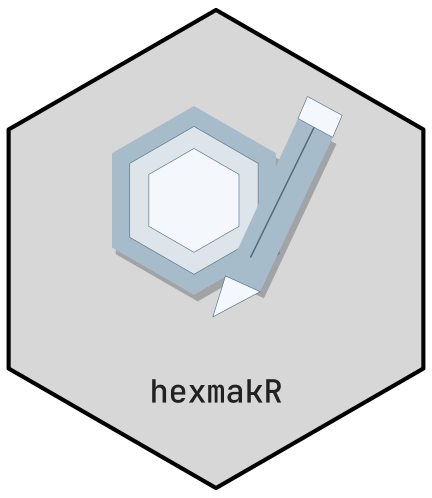

# CTTIR v5 and project logos



## Create first, reuse when useful

A new project starts with its own name and frame, without an archived
motif:

``` r

project <- logo_design("My project", shape = "pentagon")
project <- hex_add_part(project, "circle", x = .5, y = .6, r = .15)
project <- hex_add_part(project, "polygon",
                        x = c(.35, .65, .5), y = c(.45, .45, .75))
hex_layers(project)
#>           id     type    fill     col points  role   name visible
#> 1 layer_0001  polygon #191919 #000000      5 frame  Frame    TRUE
#> 2 layer_0002 pathgrob #FFFFFF    <NA>   1050  name   Name    TRUE
#> 3  part_0001   circle #009E73 #FFFFFF      1 added Circle    TRUE
#> 4  part_0002  polygon #009E73 #FFFFFF      3 added  Shape    TRUE
```

Hexagons, regular pentagons and squares share the same object, editing
API and export formats. The name is inside the lower part of the frame,
and the exterior is transparent. `layout = "motif"` creates a
transparent square without a frame or name. Add primitives there to work
from an empty canvas.

## Browse the archive

The v5 library contains 45 identities. Their 270 original SVG and 270
PDF masters are included unchanged in a compressed archive;
[`hex_asset()`](https://cttir.github.io/hexmakR/reference/hex_asset.md)
returns copies of them and renders the PNG versions from the SVG
masters, and the five icon sizes with the package renderer, on demand.
Light, dark and monochrome named masters keep the exact package name
inside the hex.

``` r

head(hex_catalog())
#>          name        repo   family      symbol      kind
#> 1    molpathR    molpathR clinical    molpathR R package
#> 2      pressR      pressR clinical      pressR R package
#> 3     scimagR     scimagR clinical     scimagR R package
#> 4 zhncommandR zhncommandR clinical zhncommandR R package
#> 5  brainwritR  brainwritR evidence  brainwritR R package
#> 6     delphyr     delphyR evidence     delphyr R package
#>                                                                    source
#> 1                 https://github.com/CTTIR/molpathR/blob/main/DESCRIPTION
#> 2                   https://github.com/CTTIR/pressR/blob/main/DESCRIPTION
#> 3                  https://github.com/CTTIR/scimagR/blob/main/DESCRIPTION
#> 4              https://github.com/CTTIR/zhncommandR/blob/main/DESCRIPTION
#> 5               https://github.com/CTTIR/brainwritR/blob/main/DESCRIPTION
#> 6 https://github.com/CTTIR/delphyR/blob/main/packages/delphyr/DESCRIPTION
#>     asset_dir
#> 1    molpathR
#> 2      pressR
#> 3     scimagR
#> 4 zhncommandR
#> 5  brainwritR
#> 6     delphyr
```

An explicit identity starts from its editable native R design; original
approved assets can be located separately:

``` r

archived <- hex_design("phenoscapR")
print(archived)
hex_asset("phenoscapR", mode = "dark", layout = "lockup", format = "svg")
```

[`hex_design()`](https://cttir.github.io/hexmakR/reference/hex_design.md)
without an explicit package also starts fresh. For a named project,
`logo_design("My project")` makes that intent explicit. Supply
`motif = "phenoscapR"` only when its full motif should be the starting
point; `icon = "microscope"` instead selects a generic icon.

## Reuse selected components

``` r

archived <- hex_design("phenoscapR")
source_layers <- hex_layers(archived)
source_layers[source_layers$role == "motif", c("id", "type", "points")]
#>            id    type points
#> 2  layer_0002   lines      7
#> 3  layer_0003   lines      2
#> 4  layer_0004 polygon     90
#> 5  layer_0005 polygon     90
#> 6  layer_0006   lines     80
#> 7  layer_0007  circle      1
#> 8  layer_0008  circle      1
#> 9  layer_0009   lines      2
#> 10 layer_0010 polygon     90
#> 11 layer_0011 polygon     90
#> 12 layer_0012   lines     80
#> 13 layer_0013  circle      1
#> 14 layer_0014  circle      1
#> 15 layer_0015   lines      2
#> 16 layer_0016 polygon     90
#> 17 layer_0017 polygon     90
#> 18 layer_0018   lines     80
#> 19 layer_0019  circle      1
#> 20 layer_0020  circle      1
#> 21 layer_0021   lines      2
#> 22 layer_0022 polygon     90
#> 23 layer_0023 polygon     90
#> 24 layer_0024   lines     80
#> 25 layer_0025  circle      1
#> 26 layer_0026  circle      1
#> 27 layer_0027   lines      2
#> 28 layer_0028 polygon     90
#> 29 layer_0029 polygon     90
#> 30 layer_0030   lines     80
#> 31 layer_0031  circle      1
#> 32 layer_0032  circle      1
#> 33 layer_0033   lines      2
#> 34 layer_0034 polygon     90
#> 35 layer_0035 polygon     90
#> 36 layer_0036   lines     80
#> 37 layer_0037  circle      1
#> 38 layer_0038  circle      1
#> 39 layer_0039 polygon     90
#> 40 layer_0040 polygon     90
#> 41 layer_0041   lines     80
#> 42 layer_0042  circle      1
#> 43 layer_0043  circle      1
#> 44 layer_0044  circle      1
#> 45 layer_0045  circle      1
#> 46 layer_0046  circle      1
first_motif <- source_layers$id[source_layers$role == "motif"][1]
project <- hex_reuse_part(project, archived, first_motif)
```

Omit `layer` to import every motif component, excluding the source frame
and name:

``` r

project <- hex_reuse_part(project, "phenoscapR")
```

The destination keeps its name, frame, palette and existing parts. Each
import stores a validated snapshot of native source settings and edits,
and remains independently editable. Imported colours therefore stay as
chosen in the source until you edit those parts. Changing an archive
selection does not alter imported artwork.

## Edit, duplicate and remove

``` r

project <- hex_edit_layer(project, "part_0001",
                          fill = "#45B59A", dx = .03, scale = .9)
project <- hex_duplicate_part(project, "part_0001")
hex_layers(project)
#>           id     type    fill     col points  role     name visible
#> 1 layer_0001  polygon #191919 #000000      5 frame    Frame    TRUE
#> 2 layer_0002 pathgrob #FFFFFF    <NA>   1050  name     Name    TRUE
#> 3  part_0001   circle #45B59A #FFFFFF      1 added Circle 1    TRUE
#> 4  part_0002  polygon #009E73 #FFFFFF      3 added    Shape    TRUE
#> 5  part_0003    lines #0C4E4B #0C4E4B      7 added     Line    TRUE
#> 6  part_0004   circle #45B59A #FFFFFF      1 added Circle 2    TRUE
```

Use current IDs from
[`hex_layers()`](https://cttir.github.io/hexmakR/reference/hex_layers.md).
Native geometry uses `layer_` IDs; additional primitives and imported
components use `part_` IDs. Adding or removing another part retains the
IDs of existing parts.

[`hex_edit_layer()`](https://cttir.github.io/hexmakR/reference/hex_edit_layer.md)
accepts fill, outline, line width, opacity, visibility, translation,
scale, rotation (`angle`) and explicit X/Y point coordinates.
Coordinates are local to the part’s viewport; supply the same number of
points. The input design is unchanged, so keeping an earlier object
provides undo in R.

``` r

project <- hex_remove_part(project, "part_0002")
```

Removing an added part deletes it. Removing a native part hides it with
a saved visibility override. `hex_edit_layer(design, id, reset = TRUE)`
removes that part’s overrides. Review edited scientific shapes at full
size and icon size because a changed silhouette can imply a different
meaning.

## Portable projects and exports

Upload local figures and vector artwork with the same project API:

``` r

project <- hex_import_art(project, "figure.svg")  # also PNG or JPEG
project <- hex_label_layer(project, "part_0001", "Central cell")
project <- hex_edit_layer(project, "part_0001", angle = 20, alpha = .8)
hex_groups(project)
project <- hex_group_layers(project, c("part_0001", "part_0002"), "Cells")
```

PNG/JPEG becomes one image part with embedded bytes; supported SVG
shapes become independently editable vector paths. Neither needs its
original file after import. SVG curves use bounded vector polylines.
Solid fills/strokes, transforms and local references are supported.
Outline text and flatten gradients, masks, filters, group opacity or
intersecting clips first; unsupported features produce an error. Uploads
are capped at 10 MiB and rasters at 8192 pixels per side and 16 million
pixels total. See
[`?hex_import_art`](https://cttir.github.io/hexmakR/reference/hex_import_art.md)
for the complete supported subset and bounds.

``` r

hex_save_design(project, "project.json")
restored <- hex_read_design("project.json")
hex_export(restored, "project.svg")
hex_export(restored, "project.png", width = 1600)
hex_export(restored, "project.pdf")
hex_recipe(restored, "reproduce.R")
```

JSON contains only supported settings, geometry and source snapshots. It
never loads executable R, external files or serialised grid objects.
Unknown fields, nested archive parts, invalid coordinates and projects
over 20 MiB are rejected. Earlier v5 JSON files remain supported and
retain their archived motif behaviour.

The bundled JetBrains Mono font supplies outlined name glyphs. Vector
exports do not depend on installed fonts. Font licences are supplied
under `system.file("cttir/source/fonts", package = "hexmakR")`. Hex
canvases use width/height `sqrt(3)/2`; pentagon, square and unframed
canvases are square.

## Manual editor

``` r

hexmakr_app()
hexmakr_app(package = "phenoscapR")  # preselect CTTIR Gallery; Designer stays fresh
```

The Designer starts with a new logo. Apply its name and frame, add
parts, then select, drag and edit individual components. Short labels
and editable groups organise the composition. CTTIR Gallery browsing
leaves the logo unchanged; adding a selected part, adding a motif, and
starting from a whole archive design are separate explicit actions.

**Undo** restores applied actions. **Reset to starting design** returns
to the fresh, explicitly loaded archive or opened-project baseline.
**Save project** and **Open saved project** preserve editable parts.
Downloads use the applied design, so apply pending form changes first.
The classic workspace remains available as
`hexmakr_app(workspace = "classic")`.

## Original catalogue and legacy references

``` r

# 45 x (2 layouts x 3 modes x 3 formats + 5 icons) = 1,035 exports
hex_render_catalog("exports")
```

This regenerates designs from native R geometry. Use
[`hex_asset()`](https://cttir.github.io/hexmakR/reference/hex_asset.md)
when the unchanged approved master is required.

The twelve names present only in the older hexstickers repository remain
legacy SVG references under `inst/cttir/legacy` in the source
repository. They are not claimed as approved v5 motifs. `hexmakeR` maps
to `hexmakR`; `delphyR` maps to `delphyr`.

`CTTIR` and `cttiR` differ only in case. The organisation’s asset
directory is `CTTIR-brand`; the R package retains `cttiR`.
`hex_catalog()$asset_dir` records this mapping to prevent collisions on
macOS and Windows. Display names keep their exact spelling. Archive and
asset hashes record the supplied originals.
