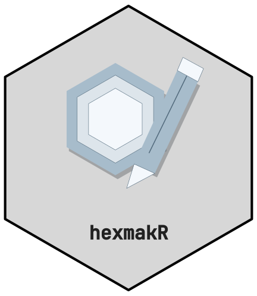
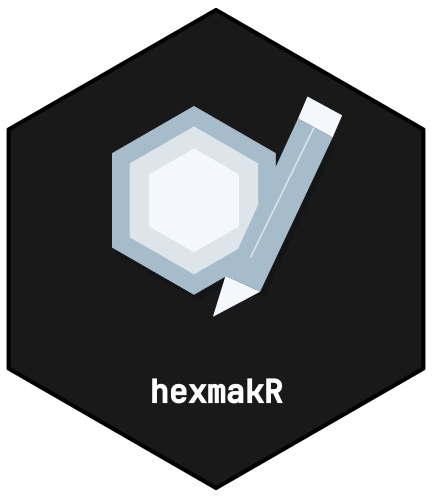
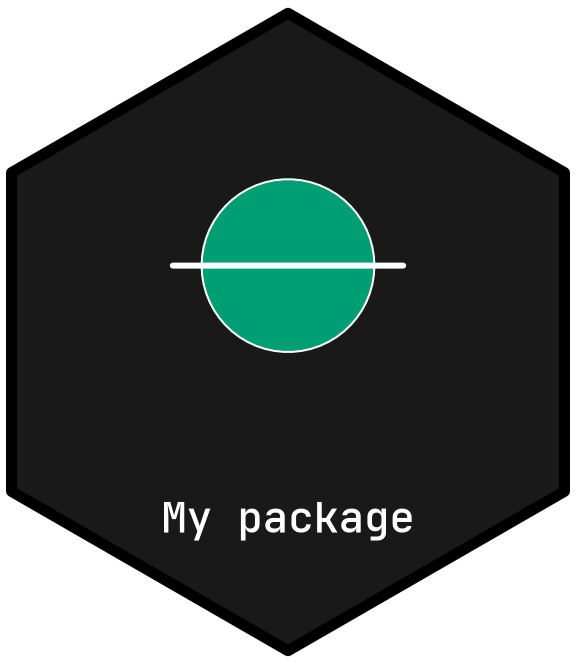
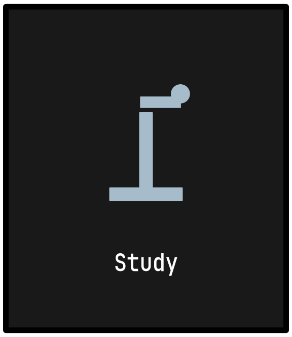

# Getting Started with hexmakR



[](https://github.com/CTTIR/hexmakR/actions/workflows/R-CMD-check.yaml)
[](https://cttir.github.io/hexmakR/)
[](https://app.codecov.io/gh/CTTIR/hexmakR?branch=main)
[](https://opensource.org/licenses/MIT)
[](https://lifecycle.r-lib.org/articles/stages.html#experimental)

## Installation

Install the development package from GitHub:

``` r

# install.packages("pak")
pak::pak("CTTIR/hexmakR")
```

## Start with a fresh logo

``` r

library(hexmakR)
design <- logo_design("My package")
```

This creates a hexagonal frame and name with no archived scientific
motif. The name sits inside the lower part of the frame. A pentagon or
square is available with `shape = "pentagon"` or `shape = "square"`.

Add your own artwork as individually editable parts:

``` r

design <- hex_add_part(design, "circle", x = .5, y = .6, r = .15)
design <- hex_add_part(design, "line",
                       x = c(.3, .7), y = c(.6, .6), col = "white", lwd = 3)
hex_layers(design)
#>           id     type    fill     col points  role   name visible
#> 1 layer_0001  polygon #191919 #000000      6 frame  Frame    TRUE
#> 2 layer_0002 pathgrob #FFFFFF    <NA>   1265  name   Name    TRUE
#> 3  part_0001   circle #009E73 #FFFFFF      1 added Circle    TRUE
#> 4  part_0002    lines #009E73   white      2 added   Line    TRUE
print(design)
```



Parts have stable IDs such as `part_0001`. The native frame and name
have `layer_` IDs. Obtain the current IDs from
[`hex_layers()`](https://cttir.github.io/hexmakR/dev/reference/hex_layers.md)
before editing.

``` r

design <- hex_edit_layer(design, "part_0001", fill = "#45B59A", dx = .04)
design <- hex_duplicate_part(design, "part_0001")
design <- hex_edit_layer(design, "part_0003", dx = -.2, scale = .7)
```

## Use an icon or archive artwork

All 46 generic icons remain available:

``` r

logo_design("Study", shape = "square", icon = "microscope")
```



Archive reuse is optional. Add selected artwork to the design you are
making:

``` r

head(hex_catalog())
#>          name        repo   family      symbol      kind
#> 1    molpathR    molpathR clinical    molpathR R package
#> 2      pressR      pressR clinical      pressR R package
#> 3     scimagR     scimagR clinical     scimagR R package
#> 4 zhncommandR zhncommandR clinical zhncommandR R package
#> 5  brainwritR  brainwritR evidence  brainwritR R package
#> 6     delphyr     delphyR evidence     delphyr R package
#>                                                                    source
#> 1                 https://github.com/CTTIR/molpathR/blob/main/DESCRIPTION
#> 2                   https://github.com/CTTIR/pressR/blob/main/DESCRIPTION
#> 3                  https://github.com/CTTIR/scimagR/blob/main/DESCRIPTION
#> 4              https://github.com/CTTIR/zhncommandR/blob/main/DESCRIPTION
#> 5               https://github.com/CTTIR/brainwritR/blob/main/DESCRIPTION
#> 6 https://github.com/CTTIR/delphyR/blob/main/packages/delphyr/DESCRIPTION
#>     asset_dir
#> 1    molpathR
#> 2      pressR
#> 3     scimagR
#> 4 zhncommandR
#> 5  brainwritR
#> 6     delphyr
design <- hex_reuse_part(design, "phenoscapR")
```

This imports the source motif’s editable parts while retaining your
name, frame, palette and existing parts. An explicit
`hex_design("phenoscapR")` instead starts from that whole archived
design. A call to
[`hex_design()`](https://cttir.github.io/hexmakR/dev/reference/hex_design.md)
without a package also starts fresh; `logo_design("My package")` is the
direct way to set your own project name.

## Save and continue later

Use `hex_import_art(design, "figure.png")` to add an embedded PNG/JPEG
image, or supply an SVG file for separately editable vector shapes.
Supported SVG curves become vector polylines. The editor provides the
same feature under **Add an image or vector drawing**. Uploads are
capped at 10 MiB; outline text and flatten gradients, masks or
intersecting clips first. See
[`?hex_import_art`](https://cttir.github.io/hexmakR/dev/reference/hex_import_art.md)
for the supported SVG subset. Item labels and groups can be organised
with
[`hex_label_layer()`](https://cttir.github.io/hexmakR/dev/reference/hex_label_layer.md)
and
[`hex_group_layers()`](https://cttir.github.io/hexmakR/dev/reference/hex_groups.md).

``` r

hex_save_design(design, "my-package.json")
restored <- hex_read_design("my-package.json")
hex_export(restored, "my-package.svg")
hex_export(restored, "my-package.png", width = 1600)
hex_export(restored, "my-package.pdf")
hex_recipe(restored, "reproduce.R")
```

PNG has a transparent exterior. SVG and PDF contain native vector
artwork and outlined name glyphs, so they do not depend on locally
installed fonts. JSON stores validated settings and parts; opening a
project does not evaluate R code. A project must fit within the same 20
MiB limit when saved and reopened.

## Open the manual editor

``` r

hexmakr_app()
```

The Designer opens a new logo. Add parts, select one, and use **Apply
part edit** after changing its colours, position, size, opacity or
points. Click a part to select it and drag it to move it. Rename items,
organise groups and switch the mouse target to move a whole group
together. The CTTIR Gallery tab is secondary; browsing it leaves the
current logo unchanged.

The original generic sticker interface remains available through
`hexmakr_app(workspace = "classic")`. Its
[`hex_sticker()`](https://cttir.github.io/hexmakR/dev/reference/hex_sticker.md)
function returns a ggplot object and supports 28 themes, led by the nine
CTTIR v5 families, font choices including the bundled JetBrains Mono,
and uploaded images.

See
[`vignette("cttir-library")`](https://cttir.github.io/hexmakR/dev/articles/cttir-library.md)
for archive reuse and editable projects, and
[`vignette("shiny-app")`](https://cttir.github.io/hexmakR/dev/articles/shiny-app.md)
for the manual workflow.
